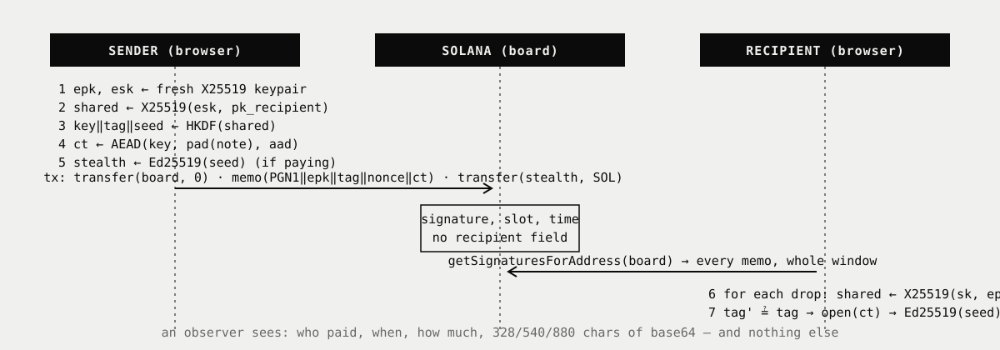
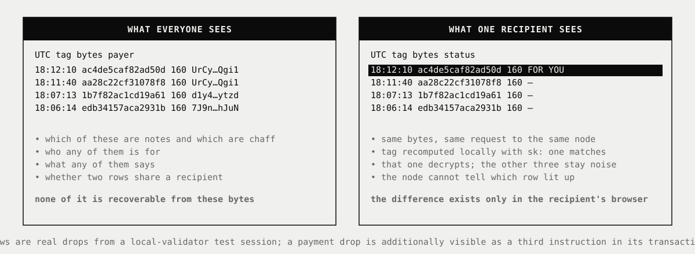

<p align="center">
  
</p>

<p align="center">
  
</p>

<h1 align="center">Whisper</h1>

<p align="center">
  <strong>Private notes and private SOL on Solana.</strong><br>
  No program. No server. No recipient on chain.
</p>

<p align="center">
  <a href="https://sirvaliance.com">sirvaliance.com</a> ·
  <a href="https://x.com/sirvaliance">@sirvaliance</a> ·
  <a href="docs/PROTOCOL.md">protocol</a> ·
  <a href="docs/THREAT-MODEL.md">threat model</a>
</p>

<p align="center">
  <sub>Developer Address: <code>8xErG7N5Xq9PLqfhA6yYBxucFVTcKstqJfQmudpA186t</code></sub>
</p>


---

**What it is.** You send someone a note, some SOL, or both. It gets posted to Solana, encrypted, with no name on it. Only the person it is for can find it and open it. Nobody else, including the people running the network, can tell who it was for or what it said.

**How, in one breath.** Every message is locked with a brand-new key made from a secret only the sender and the recipient share. It is posted to one public board where every message looks the same. The recipient downloads the whole board and tries their key on everything. Theirs open; the rest stay noise. If money came with it, it sits in a fresh wallet that only the recipient can unlock.

**What it is not.** Not a new coin, not a program on the chain, not a server holding your keys. One memo per message and standard, audited cryptography. The parts that stay visible (who paid the fee, how much, and when) are listed below, not hidden.

**Why "dead drop".** A dead drop is a hiding place two people agree on in advance. One leaves something and walks away; later the other collects it. They never meet, and nobody watching the place can tell who it was for. Whisper makes the hiding place a public board on Solana.

<p align="center"></p>

<br>

## Contents

1. [Design principles](#design-principles)
2. [How it works](#how-it-works)
   - [Identities](#1-identities)
   - [Key schedule](#2-key-schedule)
   - [Plaintext and padding](#3-plaintext-and-padding)
   - [Envelope](#4-envelope)
   - [The board and the transaction](#5-the-board-and-the-transaction)
   - [Stealth payments](#6-stealth-payments)
   - [Scanning](#7-scanning)
   - [Cover traffic](#8-cover-traffic)
   - [Security arguments](#9-security-arguments)
3. [Worked example](#worked-example)
4. [Numbers](#numbers)
5. [What the chain learns](#what-the-chain-learns)
6. [What this does not protect](#what-this-does-not-protect)
7. [Known issues](#known-issues)
8. [Compared with](#compared-with)
9. [Lineage](#lineage)
10. [Verify it yourself](#verify-it-yourself)
11. [FAQ](#faq)
12. [Run it](#run-it)
13. [Repository](#repository)
15. [Security and audit status](#security-and-audit-status)
15. [License](#license)

<br>

## Design principles

**Nothing to trust.** There is no custom on-chain program, so there is no upgrade authority, no admin key, no program to audit or to rug. There is no application server, so there is no database of users, no logs of who talked to whom, and nothing to subpoena. The client is a static page that talks to a Solana RPC endpoint of the user's choosing.

**Nothing to filter by.** A node that can answer "give me drops for X" can log that X asked. Whisper has no such query. There is no recipient field, no index, no subscription. Every reader fetches the whole board. The cost is bandwidth; the benefit is that the server learns nothing it did not already know.

**Uniform on the wire.** Real drops, replies, payments and cover traffic are the same bytes in the same shape. Plaintext is padded to fixed buckets. Chaff is sealed to a random key and is bit-for-bit indistinguishable from a real note.

**Standard primitives only.** X25519, HKDF-SHA256, XChaCha20-Poly1305, Ed25519, bech32m. All from the audited `@noble` libraries. No custom cryptography anywhere.

<br>

## How it works

**The whole construction in one paragraph, for people who read specs.** Identity `pk` is Ed25519; agreement uses its X25519 twin `pk_x`. Per drop: fresh `(esk, epk)`, `okm = HKDF-SHA256(X25519(esk, pk_x), salt = epk‖pk, info = "pigeon/v1", 72)`, split into AEAD key, 8-byte tag and a 32-byte seed. Plaintext padded to 160/320/576 bytes, sealed with XChaCha20-Poly1305, `aad = "PGN1"‖epk‖tag`, posted as a Memo in a transaction that also references a program-derived board. Payments fund `Ed25519.from_seed(seed)` in the same transaction. A sender who includes their ID signs `"pigeon/v1/sender"‖epk‖pk‖lamports‖len‖body` inside the plaintext; the from line is shown only if it verifies. Recipients fetch the whole board and trial-decrypt; one X25519 per drop. Fee payer, amount and time are public; recipient, content and payee are not. No custom program, no server.

Wire identifier `pigeon/v1`, magic bytes `PGN1`. Everything below is implemented in [`src/lib/protocol.ts`](src/lib/protocol.ts), which is pure TypeScript with no DOM or Solana dependency, and is pinned by [test vectors](docs/test-vectors.json). The normative specification is [`docs/PROTOCOL.md`](docs/PROTOCOL.md).

### 1. Identities

A Whisper identity is an Ed25519 keypair `(sk, pk)`. Its X25519 twin `(sk_x, pk_x)` for key agreement is the birational map of RFC 7748 §4.1, the same conversion Signal and libsodium use, so one key both signs and agrees.

The secret is derived from one wallet signature, not stored by a server:

```
m   = "Whisper identity (v1)\n\nSigning this message derives your drop address from your wallet.\nIt costs nothing and moves no funds. Sign it only on Whisper pages you trust."
sig = Ed25519.sign(wallet_sk, m)                         # 64 bytes, deterministic per RFC 8032
sk   = HKDF-SHA256(ikm = sig, salt = "pigeon/v1", info = "identity", L = 32)   # Ed25519 seed
pk   = Ed25519.pubkey(sk)
sk_x = clamp(SHA512(sk)[0..32])          # X25519 secret, RFC 8032 §5.1.5 scalar
pk_x = (1 + y) / (1 − y) mod p            # Edwards y → Montgomery u
```

Because Ed25519 signatures are deterministic, the same wallet always yields the same identity on any device, with nothing to back up. The signature never leaves the browser.

The public key is published as a **Whisper ID**:

```
id = bech32m("wsp", pk)          →  wsp10x64vt50ue20jsrckyfw32vt57gplpf6u62ma4lquwgshtgyjejqrpa962
```

Bech32m (BIP-350) gives a 30-bit checksum that detects up to four substitution errors, a lowercase alphabet with no ambiguous characters, and, deliberately, a string that cannot be mistaken for a base58 Solana address. A Whisper ID is not a wallet and cannot hold funds.

### 2. Key schedule

Per drop, the sender generates a fresh ephemeral keypair `(esk, epk)` and never reuses it.

```
shared = X25519(esk, pk_x_recipient)                      # sender
shared = X25519(sk_x_recipient, epk)                      # recipient, same value

okm = HKDF-SHA256( ikm  = shared,
                   salt = epk ‖ pk_recipient,
                   info = "pigeon/v1",
                   L    = 72 )

key  = okm[ 0..32]        XChaCha20-Poly1305 key
tag  = okm[32..40]        8-byte recognition tag
seed = okm[40..72]        Ed25519 seed of the one-time wallet
```

Binding `epk ‖ pk_recipient` into the salt means the derived material is specific to this pair of keys; a shared secret accidentally equal across recipients (impossible in practice, but cheap to rule out) would still yield distinct keys. The ephemeral secret is discarded after sealing, which gives sender-side forward secrecy: a sender's device captured later leaks nothing about past drops.

### 3. Plaintext and padding

```
offset  size  field
0       1     flags      bit0 = sender present   bit1 = payment
1       32    sender_pk  Ed25519 identity key, or zeros
33      64    signature  Ed25519(sender_sk, "pigeon/v1/sender" ‖ epk ‖ pk_recipient ‖ lamports ‖ length ‖ body), or zeros
97      8     lamports   u64 big-endian, zero when bit1 clear
105     2     length     u16 big-endian, byte length of body
107     n     body       UTF-8, n ≤ 469
107+n   *     padding    zeros to the bucket boundary
```

The plaintext is padded to the smallest of **160, 320 or 576** bytes that fits. An observer learns one of three sizes and nothing finer. The largest bucket is chosen so that a *payment* transaction (one signer, board reference, memo, stealth transfer) stays under Solana's 1,232-byte packet limit:

```
  65 signature block
   3 message header
 161 five account keys, compact-encoded     (payer, board, stealth, System, Memo)
  32 recent blockhash
  39 two System transfers
   4 memo instruction overhead
 ────
 304 bytes of overhead  →  928 bytes of memo  →  696 raw bytes  →  576 + 68 header + 16 tag + 36 slack

The signature binds the sender claim to this exact drop: the ephemeral key (unique per drop), the recipient, the amount and the body. A recipient shows a from line only when it verifies; a drop with a failed signature is treated as anonymous and flagged. Anonymous drops carry zeros and make no claim.
```

### 4. Envelope

```
offset  size  field
0       4     magic       "PGN1"
4       32    epk
36      8     tag
44      24    nonce       random
68      m     ciphertext  XChaCha20-Poly1305(key, nonce, aad, plaintext), m = bucket + 16

aad = magic ‖ epk ‖ tag
```

The memo text is `base64(envelope)`, at most 880 characters. XChaCha20's 192-bit nonce makes random nonces safe without any counter state, which matters for a client that has no persistent state and may run in many tabs. Authenticating `epk` and `tag` as associated data means a drop cannot be re-addressed or re-tagged without detection.

### 5. The board and the transaction

The board is a program-derived address under the Memo program. Nobody holds its key; it is a name hashed to a point off the curve.

```
board = find_program_address( [ "pigeon/v1", nfkc_lower(name) ], MemoSq4gqABAXKb96qnH8TysNcWxMyWCqXgDLGmfcHr )
public board = 9U2rxS5dfpfU13mZmtMonuMvQcDdNK5EHTgQk5dHMovq
```

A drop is one legacy transaction with one signer:

```
ix 0   System.transfer( payer → board, 0 lamports )
ix 1   Memo( base64(envelope) )
ix 2   System.transfer( payer → stealth_wallet, lamports )     payments only
```

The zero-lamport transfer exists for one reason: it places the board in the transaction's account keys, which is what makes `getSignaturesForAddress(board)` return every drop ever posted, in order, from any RPC node, forever. No indexer is required to read the board; any node with transaction history is one.

Any name up to 32 bytes hashes to its own board. A group can agree on a private one.

### 6. Stealth payments

The last 32 bytes of the HKDF output seed an Ed25519 keypair, which is a Solana wallet:

```
stealth = Ed25519.keypair_from_seed(seed)
```

The sender funds `stealth.pubkey` in the same transaction as the memo. The recipient, having opened the drop, computes the identical `seed` and therefore holds the private key of a funded wallet that has never appeared on chain before and will never be used again. They can sweep it anywhere (`balance − 5,000` lamports; the wallet pays its own fee and closes at zero) or import the key into any wallet app and spend from it directly.

Two payments to the same recipient use two unrelated ephemeral keys and therefore two unrelated wallets. An observer sees two strangers get paid.

The minimum payment is 0.001 SOL, because a new account must end up above Solana's rent-exempt threshold (890,880 lamports for an empty account).

### 7. Scanning

```
for sig in getSignaturesForAddress(board, newest first, within window):
    tx  = getTransaction(sig)
    env = parse(base64decode(memo(tx)))        skip unless magic == "PGN1"
    shared          = X25519(sk, env.epk)
    key, tag, seed  = HKDF(shared, env.epk ‖ pk)
    if tag != env.tag:      continue           one scalar multiplication per drop, no AEAD
    pt = AEAD.open(key, env.nonce, aad, env.ciphertext)
```

Cost per drop is one X25519 operation (~50 µs in the browser). The tag is a 64-bit filter: the probability that a drop not addressed to you matches your tag is 2⁻⁶⁴, and if it ever did, the AEAD would fail. The tag therefore leaks nothing about the recipient to anyone without the recipient's secret, since computing it requires `shared`.

The reference client fetches the entire window every time and never narrows the request by anything derived from the recipient's key. This is the whole privacy argument for reading: the node sees that you read the board, not which drop you came for.

### 8. Cover traffic

A chaff drop is `seal(random_pk, body, sender = ∅)` with a body length drawn from the bucket sizes. Nobody holds `random_pk`, so it opens for no one. It is structurally identical to a real note: same envelope, same bucket distribution, same instruction shape. Posting chaff at random hours means a real drop no longer stands out against silence.

### 9. Security arguments

Informal, stated so they can be checked:

- **Confidentiality** follows from the IND-CCA security of XChaCha20-Poly1305 under a key derived from a CDH-hard shared secret. Nobody without `sk_recipient` or `esk` computes `key`. `esk` is destroyed.
- **Recipient anonymity** follows from the same fact applied to `tag`. The envelope's only recipient-dependent field is a PRF output under a key the observer cannot compute. Without it, a drop to Alice and a drop to Bob are distributed identically.
- **Unlinkability** of drops to the same recipient follows from fresh ephemeral keys: `epk₁` and `epk₂` are independent uniform points, and all other fields are functions of independent shared secrets.
- **Payment unlinkability** follows from the stealth seed being a PRF output of the same secret. The funded address is a fresh Ed25519 public key with no relation to `pk_recipient` or to any other payment.
- **Integrity**: tampering with ciphertext, `epk` or `tag` fails authentication because `epk ‖ tag` is associated data. A node can withhold drops but cannot forge one that opens.
- **Sender authenticity** (when claimed) follows from EUF-CMA security of Ed25519 over a message that includes `epk` and `pk_recipient`: a valid signature can only have been produced by the holder of `sender_sk`, for this recipient, for this drop. It cannot be transplanted to another drop or another recipient. Anonymity is preserved because the signature sits inside the ciphertext.

What these arguments do **not** cover is in the next two sections.

<br>

## Worked example

Every value below is produced by `npm run vectors` from fixed inputs and asserted by `npm test`. The inputs are byte sequences chosen to be obviously synthetic; reproduce them in any language and compare.

```
recipient seed     0102030405060708090a0b0c0d0e0f101112131415161718191a1b1c1d1e1f20
recipient pk       79b5562e8fe654f94078b112e8a98ba7901f853ae695bed7e0e3910bad049664   (Ed25519)
recipient pk_x     4a3807d064d077181cc070989e76891d20dca5559548dc2c77c1a50273882b38   (X25519 twin)
Whisper ID         wsp10x64vt50ue20jsrckyfw32vt57gplpf6u62ma4lquwgshtgyjejqrpa962

ephemeral secret   808182838485868788898a8b8c8d8e8f909192939495969798999a9b9c9d9e9f
ephemeral public   493e82fc74464a59268817623d2053c5eb8e2cc4a988b4fee179ec6b010d531d
shared             c7d8a16faa6f8ec25150bc95aa5b37a657ba7b5712eafb11cff65ca32bce233f

key                02ba5b5c97c374d1183256090d6e411dc0113710f3f9260a2252738587cf9e65
tag                5babde6d1280c3e8
stealth seed       9bb336193d5b05bf5bc86779725fa6d7e52867b1a76297ad2327943870ae198d
stealth wallet     6wGaCTSu1kz2TqnJ8XmSrcSmTWQwvPKux6ctvMweocE8

sender pk          595bbb016312e926265f14dc40ecb868ea98160afb7774904e923fc607410ae9
signed message     "pigeon/v1/sender" ‖ epk ‖ recipient pk ‖ 00·8 ‖ 0005 ‖ "hello"
signature          5c24b6793ac602fd5bc5416e0c5c2602995bd25bfc05cc801bbb24d1a80c10dc
                   9754dba6b22a3c4a228970c96995b813a11e6ca3bc11fa8b30511f6d53134800

public board       9U2rxS5dfpfU13mZmtMonuMvQcDdNK5EHTgQk5dHMovq
```

The recipient, holding only the seed `0102…1f20` and reading `493e…531d` from the envelope, computes the same `shared`, the same `tag`, the same `key`, and the same stealth wallet, and verifies the sender's signature against `595b…0ae9`. Nobody else can.

<p align="center"></p>

<br>

## Numbers

Measured on the reference implementation (Node 24, single thread, one consumer laptop core). Reproduce with `npm test` and your own harness around `open()`.

| Quantity | Value |
|---|---|
| Envelope, 160-byte bucket | 244 bytes raw, 328 chars of memo |
| Envelope, 320-byte bucket | 404 bytes raw, 540 chars of memo |
| Envelope, 576-byte bucket | 660 bytes raw, 880 chars of memo |
| Body capacity | 53 / 213 / 469 UTF-8 bytes per bucket |
| Network fee per drop | 5,000 lamports (one signature), same for note, payment or chaff |
| Minimum payment | 1,000,000 lamports (0.001 SOL); rent-exempt floor is 890,880 |
| Sweep | balance − 5,000 lamports; account closes at zero |
| Tag check per drop | 0.70 ms (one X25519 + HKDF) |
| Full open per drop | 0.71 ms, plus one Ed25519 verify (~0.1 ms) when a sender is claimed |
| Scan throughput | ~1,400 drops per second per core, before RPC latency |
| Tag false-positive rate | 2⁻⁶⁴ per drop; a false match still fails AEAD |
| On-chain program | none; Memo program `MemoSq4gqABAXKb96qnH8TysNcWxMyWCqXgDLGmfcHr` |

RPC, not cryptography, bounds scan time: public nodes return 1,000 signatures per call and the client fetches transactions in batches of 20.

<br>

## What the chain learns

| Question | Answer |
|---|---|
| Who a drop is for | **Hidden.** No recipient on chain; the tag is only computable with the recipient's secret. |
| Who got paid | **Hidden.** SOL lands in a one-time wallet. Nothing links it to the Whisper ID or to other payments. |
| What it says | **Hidden.** XChaCha20-Poly1305 under an X25519 shared secret. |
| How long it is | **Mostly hidden.** Only the bucket: 160, 320 or 576 bytes. |
| Whether it carried a payment | **Visible.** A payment transaction has a third instruction. |
| How much | **Visible.** The transfer amount is public; the recipient is not. |
| Who sent it | **Partly.** The fee payer is public. Use a burner funded separately if it matters. |
| That you are reading | **Partly.** The node sees you fetched the board, not which drop you opened. |
| When | **Visible.** Block time is public. Chaff at other hours blurs the pattern. |

<br>

## What this does not protect

Written in full in [`docs/THREAT-MODEL.md`](docs/THREAT-MODEL.md). The short list:

- **Fee-payer linkage.** Your paying wallet is public. A burner funded through an exchange is still linked to that exchange account.
- **Timing correlation.** Post at 14:02, contact scans at 14:03, every day, and a patient RPC operator can guess. The same unsolved problem Tor has. Chaff, irregular hours and long-lived scanning sessions help.
- **Sweep linkage.** Moving stealth funds into your everyday wallet ties them to you from that moment. Sweep to fresh wallets or spend from the stealth key directly.
- **Amount fingerprinting.** Odd amounts repeated are a signature. Round numbers blend.
- **Recipient-side forward secrecy.** Your Whisper secret opens every drop ever sealed to you, and drops are permanent. Rotate IDs.
- **Endpoint compromise.** Keys live in the browser. A malicious extension or a tampered build reads them. Verify the build or run it locally.
- **Censorship by omission.** A node can hide drops from a scan. It cannot forge or read them. Scan through more than one endpoint if you suspect it.

<br>

## Known issues

Stated here so nobody has to discover them. Sender authenticity was an open item in an earlier draft and is now provided by the in-plaintext signature described above.

- **Replay.** Anyone can re-post an existing memo. The recipient sees the same note twice with two signatures. Harmless to privacy; the client should deduplicate by `epk`, which it does not yet do.
- **Payment drops are distinguishable from notes** by the third instruction. Amounts are public. See the threat model.
- **No recipient-side forward secrecy.** One long-lived secret opens every drop ever sealed to it.
- **Scan cost grows with the board.** No indexer yet; a busy public board means long first scans on public RPC.

<br>

## Compared with

| | Recipient hidden | Content hidden | Sender hidden | Size hidden | Needs a server | Permanent record | Cost per message |
|---|---|---|---|---|---|---|---|
| **Whisper** | yes | yes | fee payer visible | bucketed | no | yes, on chain | 5,000 lamports |
| Solana memo, plaintext | no | no | no | no | no | yes | 5,000 lamports |
| Nostr DM (NIP-04) | no, `p` tag is public | yes | no, pubkey is public | no | relays | relay-dependent | free |
| Nostr gift-wrap (NIP-17) | partly, random wrap key | yes | yes, wrapped | padded | relays | relay-dependent | free |
| Session | yes, onion routed | yes | yes | no | service nodes | no | free |
| Zcash shielded memo | yes | yes | yes (shielded) | fixed 512 B | no | yes, on chain | ZEC fee |
| Bitmessage | yes, trial decryption | yes | yes | padded | P2P network | ~2 days | proof of work |

Whisper's position: Zcash-style recipient privacy and permanence, without a privacy coin or a custom program, at the price of a visible fee payer. If the fee payer matters more than permanence, Session is the better tool. If you need shielded amounts, use Zcash.

<br>

## Lineage

| Idea | Origin | In Whisper |
|---|---|---|
| Find your own outputs by trial-decrypting everything | Zcash shielded wallets; Bitmessage | Scanning, §7 |
| Encrypted memo riding on a payment | Zcash's 512-byte memo field | The note inside a payment drop |
| Fixed-size cells so size reveals nothing | Tor | Buckets, §3 |
| Dummy traffic against a timing observer | Tor research, mixnets | Chaff, §8 |
| One-time addresses from a shared secret | Monero, ECDH stealth addresses | Stealth payments, §6 |
| Read everything so nobody knows what you wanted | Private information retrieval | Whole-board reads |
| Addresses that cannot be confused with wallets | Zcash `zs1…`, Lightning `lnbc…` | `wsp1…` IDs |

Whisper adds nothing clever to any of these. That is intentional: every piece is a known construction with known properties, assembled on a chain where the cheapest write is a memo.

<br>

## Verify it yourself

Do not take this README's word for anything. Each claim has a check.

**The cryptography matches the spec.** Fixed-input worked examples live in [`docs/test-vectors.json`](docs/test-vectors.json), regenerated by `npm run vectors` and asserted by `test/vectors.test.ts`. Reimplement §1, §2 and §6 in any language; if you get the same bytes, you agree with this code.

```bash
npm ci && npm test
```

**A bystander cannot open a drop, and the recipient can.** The smoke test posts a note and a 0.5 SOL payment to a fresh identity on a live validator, scans the board back, asserts a third identity's tag does not match and its decryption fails, derives the stealth wallet from the recipient side, checks its balance, and sweeps it to a fresh key.

```bash
solana-test-validator --reset --log
RPC=http://127.0.0.1:8899 npm run smoke
```

**What a drop looks like on chain.** Open any signature from the Board page in Solana Explorer. You will see a fee payer, a zero-lamport transfer to the board, a memo of base64 that decodes to `PGN1…`, and, for payments, a transfer to an address with no prior history. You will not see a recipient, because there is none to see.

**The protocol file has no network access.** [`src/lib/protocol.ts`](src/lib/protocol.ts) imports only `@noble/*` and `bs58`. It runs under plain Node in the tests. Read it; it is under 300 lines.

<br>

## FAQ

**Why Solana?** A memo costs 5,000 lamports and confirms in under a second, and `getSignaturesForAddress` lets every node serve the whole board without an indexer. The same construction works on any chain with cheap arbitrary data and address-indexed history.

**Why no custom program?** Because then there would be something to trust. A program has an upgrade authority or it does not; either way readers have to reason about it. The Memo program is immutable and does nothing.

**Why not just encrypt a memo to someone's wallet key?** The memo would still carry a recipient, a wallet key is a signing key not an agreement key, and every message to the same person would be linkable. Whisper fixes all three.

**Is a Whisper ID a wallet?** No. It is an X25519 public key and cannot hold funds. It is deliberately formatted (`wsp1…`) so it cannot be pasted into a wallet by mistake.

**Can the site operator read messages?** No. The operator serves static files and, optionally, proxies RPC calls. Keys never leave the browser, and the proxy sees ciphertext that is already public on chain.

**Is there a token?** The project has one public wallet, shown on the Wallet page of the app and nowhere else. The protocol does not require or use any token.

<br>

## Run it

Node 24 or newer.

```bash
npm install
npm run dev        # http://localhost:5180
npm test           # unit tests and test vectors, pure Node
npm run build      # type-check and production bundle
```

In the app: **Identity**, connect a wallet, sign once to derive your Whisper ID. **Drop**, paste an ID, write a note or enter SOL, send. **Board** shows every drop with yours inverted; **Inbox** shows what opened, and for payments the one-time wallet with sweep and key export.

<br>

## Repository

```
src/lib/protocol.ts    sealing, opening, IDs, signatures, wire format. Pure TypeScript, no DOM, no Solana.
src/lib/bech32.ts      bech32m for Whisper IDs
src/lib/board.ts       board address, posting, scanning
src/lib/stealth.ts     one-time wallets: derive, fund, sweep, export
src/state/             settings, identity, signer, board cache, auto-scan
src/pages/             Home · Board · Drop · Inbox · Identity · Wallet · Protocol
scripts/               live-validator smoke test, test-vector generator
test/                  node --test suites, including the vectors
docs/                  PROTOCOL · THREAT-MODEL · ARCHITECTURE · DEPLOYMENT · test-vectors.json
```

<br>

## Security

The cryptographic primitives come from the audited `@noble` libraries. The protocol and application are open for review and have not yet had an independent audit; see [docs/THREAT-MODEL.md](docs/THREAT-MODEL.md) for exactly what is and is not protected.

Vulnerabilities: see [SECURITY.md](SECURITY.md). Please do not open public issues for anything that could affect users.

<br>

## License

[MIT](LICENSE).

<p align="center"><br><sub>Leave it. Walk away.</sub></p>
